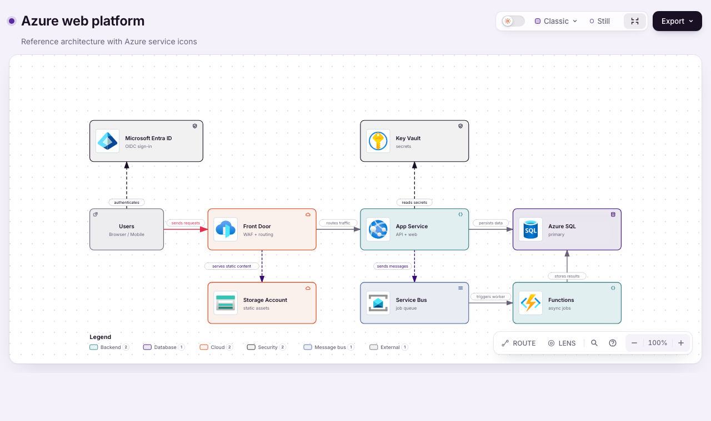

# Simform Archify

**Interactive architecture diagrams in Simform's brand, with official Azure icons, ready to embed in SharePoint.**

<p>
  <a href="CHANGELOG.md#320--2026-10-18"></a>
  <a href="LICENSE"></a>
  
</p>

**Current stable version:** `v3.2.0` (upstream Archify 3.2.0 plus the Simform changes below). See [Changelog](CHANGELOG.md#320--2026-10-18).

Describe a system to your AI agent. Simform Archify turns it into one checked, self-contained HTML file you can explore (click a node, trace a route, switch light and dark) and export as an image. It is Simform's fork of [Archify](https://github.com/tt-a1i/archify) by tt-a1i.

<p align="center"></p>

## What this fork changes

| | Upstream Archify | Simform Archify |
| --- | --- | --- |
| Look | Slate and neon, JetBrains Mono | Simform design system: lavender canvas, plum text, Inter, one red accent. Light by default, dark available. |
| Icons | 107 brand marks (AWS, GitHub, ...) | Same, plus 1,097 official Microsoft icons: Azure, Microsoft 365, Entra, Fabric, Dynamics 365 |
| SharePoint | Not addressed | Embed guide and a tested iframe mode |
| Skill name | `archify` | `simform-archify` |
| Update notices | Point at upstream releases | Off by default |

Everything else (ten diagram types, validation, layout repair, the interactive viewer, exports) is upstream's. Each choice and how to reverse it is in [DECISIONS.md](DECISIONS.md).

## Install

Simform Archify is an agent skill. It needs Node 18 or later and works with Claude Code, Cursor, Codex CLI and OpenCode.

```bash
npx -y skills@latest add SimformSolutionsPvtLtd/simform-archify --list --full-depth
```

Check that the list shows exactly one skill named `simform-archify`, then install it for your agent (drop `--global` for this project only):

```bash
npx -y skills@latest add SimformSolutionsPvtLtd/simform-archify --skill simform-archify --agent claude-code --global --copy --yes
```

If the repository is private and the installer cannot clone it, clone it yourself and install from the checkout:

```bash
git clone git@github.com:SimformSolutionsPvtLtd/simform-archify.git
npx -y skills@latest add ./simform-archify --skill simform-archify --agent claude-code --global --copy --yes
```

Use `--copy` for a local checkout so the install does not point into a folder you might move. Verify the install (the path is where the installer put the skill):

```bash
node <installed-path>/bin/archify.mjs doctor
```

## Make a diagram

Ask your agent in plain language:

```text
Use Simform Archify to diagram our web platform on Azure: users reach Front Door,
which routes to App Service; the app reads Key Vault secrets, queries Azure SQL
and queues jobs on Service Bus, drained by Functions. Entra ID signs users in.
```

The agent writes a JSON description, runs `finalize` (validation, layout checks, a real-browser check) and gives you an HTML file. Continue in conversation: "add Cosmos DB", "highlight the sign-in path", "show it dark".

Try the bundled example without an agent:

```bash
node archify/bin/archify.mjs render architecture archify/examples/azure-web-platform.architecture.json azure-web-platform.html --quality showcase
```

## Azure and Microsoft icons

Put an icon on a node with the `brand` field, by service name or alias:

```json
{ "id": "kv", "type": "security", "label": "Key Vault", "sublabel": "secrets",
  "brand": "key vault", "pos": [490, 120], "size": [210, 76] }
```

| Pack | Prefix | Icons | Examples |
| --- | --- | --- | --- |
| Azure | `azure-` | 639 | App Services, Kubernetes Services, SQL Database, Front Door |
| Microsoft 365 | `m365-` | 360 | SharePoint, Teams, Project and Planner glyphs |
| Microsoft Entra | `entra-` | 7 | Entra ID, Verified ID, Private Access |
| Microsoft Fabric | `fabric-` | 75 | Lakehouse, Pipeline, Power BI, OneLake |
| Dynamics 365 | `d365-` | 16 | Sales, Finance, Business Central |

Find an id with `node archify/bin/archify.mjs brands "service bus"`. Aliases such as `aks`, `app service`, `azure sql`, `front door` and `entra` work too. An unknown name fails validation and lists the closest icons; it never falls back to a lookalike.

Rules (also in [references/azure-icons.md](archify/references/azure-icons.md), which the skill reads):

- Label the node with the service name. Microsoft's terms ask for the name beside the icon.
- Icons are never recoloured, cropped or reshaped, and must not stand for a non-Microsoft product.
- Architecture diagrams draw the icon at 48px in a left gutter with the label beside it. Size icon nodes about 210×76 or larger; narrower nodes fail validation rather than clip the label.
- Workflow, sequence, data-flow and lifecycle diagrams keep a 24px corner icon, so give those nodes at least 160px of width.
- Icons work on architecture, workflow, sequence, data-flow and lifecycle diagrams.

The icons are unmodified copies of Microsoft's downloads. Sources, archive hashes and licence terms are in [archify/icon-packs/SOURCES.md](archify/icon-packs/SOURCES.md). To refresh them:

```bash
npm --prefix archify run sync:icon-packs   # fetch latest from Microsoft's pages, rewrite icon-packs/
npm --prefix archify run check:icon-packs  # verify hashes and SVG safety, offline
```

## Branding

The default theme applies the Simform design system: canvas `#f4f1fb`, white panels, text `#1a1024`, Inter, and brand red `#e0314c` for the one emphasised flow (coral `#ef5366` in dark mode). Node categories use the purple, teal, orange and neutral ramp, never red. [DECISIONS.md D-04](DECISIONS.md#d-04-node-type-colours-use-the-simform-palette-never-red) lists every colour.

To change the look, edit the token blocks at the top of `viewer/viewer.css`, then regenerate the viewer template and re-render the examples:

```bash
node scripts/generate-viewer.mjs
npm --prefix archify run render:examples
```

`archify/assets/template.html` is generated; never edit it by hand.

## Embed in SharePoint

A diagram is one self-contained HTML file with no network requests. SharePoint will not run it from a document library, so host it on an HTTPS site (an Azure Storage static website or Static Web Apps works) and embed it with the **Embed** web part:

```html
<iframe src="https://YOUR-HOST/azure-web-platform.html?present=1&theme=light"
        title="Azure web platform architecture" width="100%" height="680"
        style="border:0" loading="lazy" allow="fullscreen"></iframe>
```

`?present=1` keeps the diagram interactive and fills the frame; `?embed=1` shows the bare diagram. The host must allow framing by your SharePoint origin, and a site admin must allow the host under *HTML Field Security*. Full steps, parameters and caveats: [archify/references/sharepoint-embed.md](archify/references/sharepoint-embed.md). This was checked in a sandboxed iframe in headless Chrome, not in a live tenant.

## Develop

```bash
npm ci
npm --prefix archify ci
npm test                          # core smoke: ten diagram types through the public CLI
npm run test:focus -- test/icon-packs.test.mjs
npm run test:generated            # viewer, brand marks, icon packs, validators, golden examples
npm run test:full                 # everything
```

Read [CONTRIBUTING.md](CONTRIBUTING.md) before changing shared behaviour. After changing anything under `viewer/`, run `node scripts/generate-viewer.mjs`. After changing the skill's files, rebuild the package archive with `scripts/build-zip.sh` (it needs Node 22).

Layout of what this fork added:

| Path | Purpose |
| --- | --- |
| `archify/icon-packs/` | Curated Microsoft SVGs, `catalog.json`, `aliases.json`, `SOURCES.md`, terms files |
| `archify/scripts/sync-icon-packs.mjs` | Download, curate and verify the icon packs |
| `archify/renderers/shared/icon-packs.mjs` | Catalogue lookup, SVG safety check, id namespacing |
| `archify/references/azure-icons.md`, `sharepoint-embed.md` | Skill instructions for icons and embedding |
| `archify/examples/azure-web-platform.architecture.json` | Azure sample |
| `DECISIONS.md` | Every fork decision, with how to reverse it |

## Stay in sync with upstream

```bash
git remote add upstream https://github.com/tt-a1i/archify.git
git fetch upstream
git merge upstream/main
```

Expect conflicts in `viewer/viewer.css`, `viewer/template.source.html`, `archify/SKILL.md` and `archify/renderers/shared/brand-marks.mjs`. Resolve them, run `node scripts/generate-viewer.mjs` rather than merging `archify/assets/template.html`, re-render the examples, and rerun `npm run test:generated`. See D-16 in [DECISIONS.md](DECISIONS.md).

## Licence and attribution

Simform Archify is distributed under the Apache License 2.0 ([LICENSE](LICENSE), [NOTICE](NOTICE)). It is derived from [tt-a1i/archify](https://github.com/tt-a1i/archify), which originated from Cocoon-AI/architecture-diagram-generator; their copyright notices are preserved. Changes by Simform are recorded in git history and [DECISIONS.md](DECISIONS.md).

Third-party material: Inter (SIL Open Font License 1.1, `archify/assets/Inter-OFL.txt`), Simple Icons marks (see [THIRD_PARTY_NOTICES.md](THIRD_PARTY_NOTICES.md)), and Microsoft icons under Microsoft's terms (architecture diagrams, training material and documentation; not to be altered). Microsoft, Azure, Entra, Fabric, Dynamics 365 and Microsoft 365 are trademarks of Microsoft Corporation; their use here does not imply endorsement.

The translated READMEs (`README_ZH.md`, `README_JA.md`, `README_KO.md`) are upstream's and describe upstream Archify.
